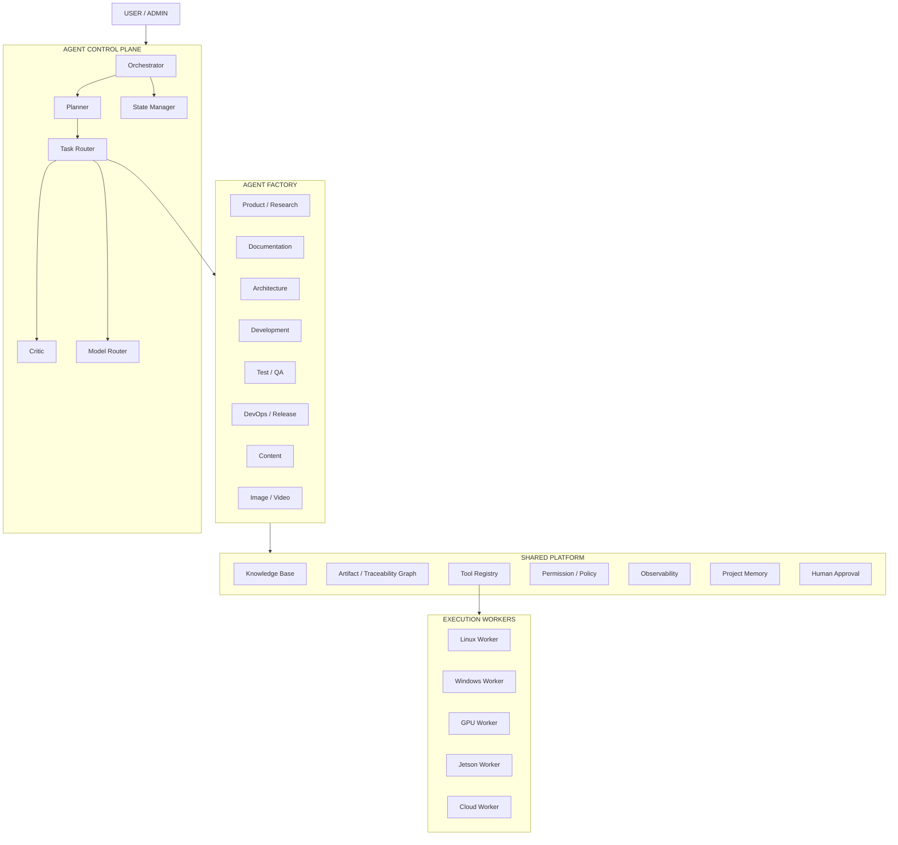
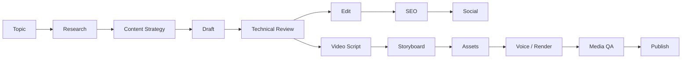

# AI WORK FACTORY — IMPLEMENTATION PLAN

**Version:** 0.1  
**Status:** Initial implementation plan  
**Purpose:** Xây dựng một nền tảng multi-agent phục vụ toàn bộ vòng đời công việc: từ ý tưởng, nghiên cứu, tài liệu, content/video cho đến software engineering đầy đủ gồm architecture, coding, test, review, QA, CI/CD và release.

---

## 1. TẦM NHÌN

Xây dựng một **AI Work Factory** hoạt động như một “công ty AI thu nhỏ”, trong đó người dùng đóng vai trò **Admin / Product Owner / Final Approver**, còn hệ thống chịu trách nhiệm phân rã mục tiêu, điều phối agent, tạo artifact, thực thi workflow, kiểm tra chất lượng và lưu trace toàn bộ quyết định.

Hệ thống không được thiết kế như một nhóm chatbot nói chuyện tự do. Mô hình vận hành phải là:

```text
GOAL
  ↓
PROJECT
  ↓
WORKFLOW
  ↓
TASK GRAPH
  ↓
AGENT / WORKER
  ↓
ARTIFACT
  ↓
QUALITY GATE
  ↓
HUMAN APPROVAL / NEXT STAGE
```

Nguyên tắc cốt lõi:

1. **Artifact-driven, không chat-driven.**
2. **Workflow có trạng thái**, không cho agent hội thoại vô hạn.
3. **Mỗi agent có contract rõ ràng:** input, output, tool, permission, definition of done.
4. **Mọi output quan trọng phải version hóa.**
5. **Quality gate bắt buộc** tại các bước quan trọng.
6. **Human-in-the-loop** cho kiến trúc, merge/release, thao tác phá hủy hoặc production.
7. **Agent chỉ quyết định trong phạm vi quyền hạn.** Worker/tool thực thi hành động có kiểm soát.
8. **Observability là chức năng lõi**, không phải add-on sau này.

---

## 2. PHẠM VI HỆ THỐNG

### 2.1 Software Factory

Phục vụ chu trình:

```text
Idea
→ Research
→ PRD / Requirement
→ Architecture
→ Task Breakdown
→ Coding
→ Unit Test
→ Static Analysis
→ Code Review
→ Integration Test
→ QA
→ Security
→ CI
→ Staging
→ E2E
→ Release Approval
→ Production
→ Monitoring
→ Feedback
```

### 2.2 Content Factory

Phục vụ chu trình:

```text
Topic / Product / Release
→ Research
→ Content Strategy
→ Article / Blog
→ Social Content
→ Video Script
→ Storyboard
→ Image / Asset
→ Voice
→ Video Render
→ Subtitle / Thumbnail
→ QA
→ Publish
```

### 2.3 Shared Platform

Hai factory dùng chung:

- Orchestrator
- Planner
- Task Router
- Critic
- Workflow Engine
- Agent Runtime
- Model Router
- Knowledge / Project Memory
- Artifact Store
- Traceability Graph
- Tool Registry
- Permission / Policy Engine
- Worker Scheduler
- Sandbox Manager
- Observability
- Human Approval

---

## 3. MỤC TIÊU TRIỂN KHAI

### Mục tiêu ngắn hạn

Xây được một MVP có thể xử lý một repository thật theo pipeline:

```text
Requirement
→ Architecture
→ Task
→ Coding
→ Build
→ Test
→ Review
→ Fix
→ QA
→ PR
```

### Mục tiêu trung hạn

- Chạy song song nhiều coding task trong sandbox riêng.
- Có Windows/Linux/Jetson worker.
- Có dashboard theo dõi task, run, artifact, cost, lỗi.
- Có knowledge base và project memory.
- Có CI/CD và production approval.

### Mục tiêu dài hạn

Người dùng nhập một objective cấp cao, ví dụ:

> “Thêm obstacle segmentation vào perception-service và chuẩn bị tài liệu, demo, release note.”

Hệ thống tự tạo và thực hiện:

```text
Research
Architecture
Task Graph
Code
Tests
Docs
PR
Release Note
Technical Article
Demo Script / Video
```

Người dùng chỉ phải can thiệp tại các gate quan trọng.

---

## 4. KIẾN TRÚC TỔNG THỂ



---

## 5. CONTROL PLANE

### 5.1 Orchestrator

Trách nhiệm:

- Nhận objective từ người dùng.
- Chọn workflow phù hợp.
- Tạo project/run.
- Theo dõi task graph.
- Gọi Planner, Router, Critic.
- Dừng workflow khi gate thất bại.
- Yêu cầu human approval.
- Khởi động retry hoặc remediation workflow.

Orchestrator **không nên trực tiếp code**.

### 5.2 Planner

Chuyển objective thành:

```text
Project
→ Epic
→ Feature
→ Task
→ Dependency
→ Acceptance Criteria
```

Output chuẩn:

- `project-plan.md`
- `task-graph.json`
- ticket/task records trong database.

### 5.3 Task Router

Quyết định:

- task dùng role nào;
- model class nào;
- worker nào;
- tool nào;
- sandbox nào;
- có cần human approval hay không.

### 5.4 Critic

Critic không tạo sản phẩm chính. Nó kiểm tra:

- output có đúng requirement không;
- có evidence không;
- có contradiction không;
- có thiếu acceptance criteria không;
- có vượt quyền không;
- có đủ chất lượng để qua gate không.

Critic khác Code Reviewer: Critic làm **cross-domain quality control**, Reviewer tập trung vào code.

### 5.5 State Manager

Task state chuẩn:

```text
NEW
READY
RUNNING
WAITING
REVIEW
CHANGES_REQUIRED
APPROVAL_REQUIRED
FAILED
CANCELLED
DONE
```

---

## 6. AGENT MODEL

Không tạo hàng chục service agent độc lập. Dùng mô hình:

```text
AGENT INSTANCE
=
Runtime
+ Role Profile
+ Tool Set
+ Permission
+ Context
+ Model Route
```

### Role profiles ban đầu

#### Product / Planning
- Researcher
- Product Manager / BA
- Planner

#### Engineering
- Solution Architect
- Tech Lead
- Backend Developer
- Frontend Developer
- C++ Developer
- Embedded Developer
- ROS2 / Robotics Developer
- Test Engineer
- Code Reviewer
- QA Engineer
- Security Reviewer
- DevOps / Release

#### Documentation / Content
- Technical Writer
- Content Strategist
- Copywriter
- Scriptwriter
- Storyboard Agent
- Media QA

---

## 7. AGENT CONTRACT

Mỗi role phải được định nghĩa bằng machine-readable contract.

Ví dụ:

```yaml
id: engineering.solution-architect
version: 1

role:
  name: Solution Architect
  objective: Convert approved requirements into an implementable architecture package.

inputs:
  required:
    - prd
    - non_functional_requirements
  optional:
    - existing_architecture
    - company_standards

outputs:
  required:
    - architecture.md
    - adr/*
    - component-diagram.mmd
    - api-spec.yaml

permissions:
  git_read: true
  docs_write: true
  source_code_write: false
  production_access: false

quality_gate:
  required_sections:
    - constraints
    - alternatives
    - tradeoffs
    - failure_modes
    - security_considerations

human_approval: true
```

### Contract bắt buộc có

- role/objective
- input schema
- output schema
- allowed tools
- permissions
- quality gate
- retry policy
- timeout policy
- human approval rule

---

## 8. WORKFLOW ENGINE

Workflow phải là config/data, không hard-code vào Orchestrator.

### Workflow software development

```yaml
id: software-development
version: 1

stages:
  - requirement
  - architecture
  - planning
  - development
  - verification
  - review
  - qa
  - release
```

### Workflow content

```yaml
id: content-production
version: 1

stages:
  - research
  - content-plan
  - draft
  - technical-review
  - edit
  - seo
  - publish
```

### Workflow video

```yaml
id: video-production
version: 1

stages:
  - research
  - script
  - storyboard
  - asset-generation
  - voice
  - render
  - subtitle
  - media-qa
  - publish
```

---

## 9. ARTIFACT MODEL

Artifact là đơn vị trung tâm của hệ thống.

### Artifact classes

- Requirement
- PRD
- User Story
- ADR
- Architecture Document
- API Spec
- Source Change
- Pull Request
- Test Plan
- Test Report
- QA Report
- Security Report
- Build Artifact
- Container Image
- Release
- Article
- Image
- Video
- Storyboard

### Versioning

- Code/docs text: Git.
- Binary/image/video/model: MinIO/S3-compatible storage.
- Metadata/relationship: PostgreSQL.

---

## 10. TRACEABILITY GRAPH

Hệ thống phải biết quan hệ giữa requirement, decision, code và test.

Ví dụ:

```text
REQ-014
  ↓ implements
ADR-003
  ↓ affects
MODULE-camera
  ↓ changed_by
PR-043
  ↓ verified_by
TEST-REPORT-043
  ↓ included_in
RELEASE-1.3.0
```

Ứng dụng:

- Impact analysis khi requirement thay đổi.
- Tìm test bị ảnh hưởng.
- Truy vết bug về decision/code.
- Sinh release note tự động.
- Audit đầy đủ.

MVP chưa cần Neo4j. Dùng PostgreSQL edges/table trước; chỉ thêm graph DB khi truy vấn quan hệ trở nên phức tạp.

---

## 11. MEMORY & KNOWLEDGE

### L1 — Run Context

Chỉ chứa context của task hiện tại.

### L2 — Project Memory

- project decisions
- architecture
- coding conventions
- task history
- known issues

### L3 — Company Knowledge

- coding standards
- documentation standards
- UI/design guidelines
- security policy
- release policy
- reusable architecture patterns

### L4 — Semantic Knowledge

Dùng pgvector cho RAG theo project/domain.

Khuyến nghị MVP:

```text
PostgreSQL + pgvector
Git
MinIO
```

---

## 12. MODEL ROUTER

Không dùng model mạnh nhất cho mọi task.

### Model classes

```text
FAST
BALANCED
REASONING
MULTIMODAL
LOCAL_PRIVATE
CODE_SPECIALIST
```

Ví dụ policy:

```text
rename/refactor nhỏ       → FAST
unit test generation      → BALANCED
architecture              → REASONING
code review               → REASONING
log summarization         → FAST
image/video understanding → MULTIMODAL
sensitive code            → LOCAL_PRIVATE khi cần
```

Router cần ghi log:

- model selected
- reason
- token usage
- cost
- latency
- success/retry

---

## 13. TOOL LAYER

Agent không được quyền shell tùy ý theo mặc định.

Mô hình:

```text
Agent
 ↓
Tool API
 ↓
Policy Engine
 ↓
Worker
 ↓
OS / Service
```

### Tool groups ban đầu

#### Git
- clone
- checkout
- create_branch
- diff
- commit
- push
- open_pr

#### Build
- cmake_build
- dotnet_build
- npm_build
- python_package

#### Test
- ctest
- pytest
- dotnet_test
- playwright

#### DevOps
- docker_build
- docker_run
- deploy_staging
- deploy_production

#### Docs
- read/write markdown
- generate mermaid
- generate OpenAPI

#### Media
- image generation
- ffmpeg render
- subtitle generation

---

## 14. PERMISSION MODEL

Dùng RBAC + action policy.

### Permission level

```text
LEVEL 0 — AUTO
LEVEL 1 — AUTO + NOTIFY
LEVEL 2 — APPROVAL REQUIRED
LEVEL 3 — MANUAL EXECUTION
```

Ví dụ:

| Action | Level |
|---|---:|
| Generate documentation | 0 |
| Run tests | 0 |
| Create branch | 0 |
| Open PR | 0 |
| Deploy staging | 1 |
| Merge protected branch | 2 |
| Deploy production | 2 |
| Delete database / secret rotation | 3 |

---

## 15. SANDBOX MANAGER

Mỗi coding task chạy trong workspace tách biệt.

```text
/workspaces/
  TASK-1001/
  TASK-1002/
  TASK-1003/
```

Khuyến nghị:

- Git worktree hoặc clone ephemeral.
- Container cho Linux task.
- Windows sandbox/isolated workspace cho .NET/WPF.
- Cleanup sau khi PR được merge hoặc task bị hủy.

Không cho nhiều coding agent dùng chung một working tree.

---

## 16. WORKER ARCHITECTURE

Worker là execution node, không nhất thiết chứa LLM.

### Worker types

- Linux Worker
- Windows Worker
- GPU Worker
- Jetson Worker
- Cloud Worker

### Scheduler chọn worker theo capability

Ví dụ:

```text
WPF/.NET Desktop Build       → Windows Worker
ROS2 / Ubuntu Build          → Linux Worker
RealSense / CUDA HIL Test    → Jetson Worker
Image / Video / Local LLM    → GPU Worker
Generic container workload   → Linux/Cloud Worker
```

Worker heartbeat phải báo:

- online/offline
- OS
- CPU/RAM/GPU
- installed capabilities
- current jobs
- load

---

## 17. CODING WORKFLOW CHUẨN

```mermaid
flowchart LR
    R[Requirement] --> A[Architecture]
    A --> P[Planning]
    P --> C[Coding]
    C --> U[Unit Test]
    U --> S[Static Analysis]
    S --> CR[Code Review]
    CR --> I[Integration Test]
    I --> Q[QA]
    Q --> SEC[Security]
    SEC --> CI[CI]
    CI --> STG[Staging]
    STG --> E2E[E2E]
    E2E --> H[Human Approval]
    H --> REL[Release]
    REL --> MON[Monitoring]
```



### Gate tối thiểu trước merge

- build pass
- lint/static analysis pass
- unit test pass
- integration test pass nếu có
- không có critical/high security issue
- reviewer pass
- acceptance criteria satisfied

### Gate production

- staging pass
- E2E pass
- QA sign-off
- release artifact immutable
- rollback plan tồn tại
- human approval

---

## 18. CONTENT / MEDIA WORKFLOW



Một software release có thể kích hoạt content workflow để sinh:

- changelog
- release note
- technical article
- social post
- demo script
- demo video

---

## 19. OBSERVABILITY

Mọi agent run phải ghi:

- Run ID
- Project ID
- Workflow ID
- Agent role
- Model
- Prompt/profile version
- Input artifacts
- Output artifacts
- Tool calls
- Duration
- Token usage
- Estimated cost
- Retry count
- Error
- Critic result
- Human feedback

### Dashboard MVP

#### Overview
- active projects
- active tasks
- failed tasks
- waiting approvals
- worker health

#### Project
- workflow graph
- task states
- artifacts
- PR/build/test status
- cost

#### Agent
- run count
- success rate
- retry rate
- rejection rate
- average latency
- average cost

---

## 20. SECURITY & GUARDRAILS

Bắt buộc:

- secrets không đưa vào prompt.
- secrets lưu qua Vault/secret manager hoặc environment injection.
- branch protection.
- production credential tách khỏi agent runtime.
- audit log không sửa được.
- tool permission theo role.
- command allowlist/structured tools.
- dependency/license scan.
- secret scanning.
- sandbox isolation.
- network policy cho worker nhạy cảm.

---

## 21. RECOMMENDED MVP STACK

### Backend / Control Plane

- Python
- FastAPI
- Pydantic
- SQLAlchemy
- PostgreSQL
- pgvector
- Redis

### Workflow

Khuyến nghị đầu tiên: tự xây state-machine đơn giản trên database + queue để hiểu rõ domain. Có thể bổ sung Temporal/LangGraph sau khi requirements ổn định.

### Execution

- Docker
- Git worktree
- native Windows worker service
- native/Linux worker daemon

### Storage

- Git repository
- PostgreSQL
- MinIO

### Dashboard

- Next.js / React

### Observability

- OpenTelemetry
- Prometheus/Grafana về sau
- structured logs ngay từ MVP

### CI

- GitHub Actions hoặc GitLab CI tùy nơi host code.

---

## 22. REPO STRUCTURE ĐỀ XUẤT

```text
ai-work-factory/
├── apps/
│   ├── control-api/
│   └── dashboard/
│
├── core/
│   ├── orchestrator/
│   ├── planner/
│   ├── router/
│   ├── critic/
│   ├── workflow/
│   ├── state/
│   └── model-router/
│
├── agents/
│   ├── contracts/
│   ├── profiles/
│   └── prompts/
│
├── tools/
│   ├── git/
│   ├── build/
│   ├── test/
│   ├── docker/
│   ├── deploy/
│   ├── docs/
│   └── media/
│
├── workers/
│   ├── common/
│   ├── linux/
│   ├── windows/
│   ├── gpu/
│   └── jetson/
│
├── workflows/
│   ├── software-development.yaml
│   ├── content-production.yaml
│   └── video-production.yaml
│
├── knowledge/
│   ├── company/
│   ├── engineering/
│   ├── robotics/
│   └── templates/
│
├── infrastructure/
│   ├── docker/
│   ├── migrations/
│   └── monitoring/
│
├── tests/
│   ├── unit/
│   ├── integration/
│   └── e2e/
│
└── docs/
    ├── architecture/
    ├── adr/
    ├── api/
    ├── security/
    └── operations/
```

---

## 23. ROADMAP TRIỂN KHAI

### PHASE 0 — FOUNDATION / PoC

**Mục tiêu:** chứng minh Orchestrator → Agent → Artifact → Gate hoạt động.

Build:

- project model
- task/state model
- workflow config
- agent contract
- one Linux worker
- Git tool
- filesystem/docs tool
- logging

Agent:

- Architect
- Developer
- Tester
- Reviewer

Demo workflow:

```text
Requirement
→ Architecture
→ Code
→ Test
→ Review
```

**Exit criteria:** một task code thật tạo được PR hoặc patch cùng test report và review report.

---

### PHASE 1 — DEVELOPMENT FACTORY MVP

Thêm:

- Planner
- Critic
- QA
- CI integration
- sandbox manager
- PostgreSQL metadata
- dashboard cơ bản
- human approval

Workflow:

```text
Requirement
→ Architecture
→ Planning
→ Coding
→ Build/Test
→ Review
→ Fix Loop
→ QA
→ PR
```

**Exit criteria:** xử lý được một feature end-to-end trên repo thật.

---

### PHASE 2 — DISTRIBUTED WORKERS + CI/CD

Thêm:

- Windows Worker
- Jetson Worker
- GPU Worker
- worker capability registry
- scheduler
- staging deploy
- security scan
- release workflow

**Exit criteria:** task tự được route sang đúng machine và kết quả quay về control plane.

---

### PHASE 3 — KNOWLEDGE + TRACEABILITY

Thêm:

- pgvector
- project memory
- company knowledge
- artifact relations
- impact analysis
- semantic search

**Exit criteria:** khi requirement thay đổi, hệ thống xác định được artifact/task liên quan.

---

### PHASE 4 — CONTENT FACTORY

Thêm:

- Research
- Content Strategist
- Copywriter
- SEO
- Scriptwriter
- Storyboard
- Image/Video tools
- media QA

**Exit criteria:** từ một product/release sinh được article + social + video package.

---

### PHASE 5 — AUTONOMOUS WORK FACTORY

Thêm:

- multi-project scheduler
- budgets
- automatic remediation
- adaptive routing
- agent quality scoring
- reusable workflow templates

**Exit criteria:** một objective cấp cao có thể chạy qua nhiều team, chỉ dừng tại human gate.

---

## 24. MVP BACKLOG ĐỀ XUẤT

### Epic A — Core Domain

- Project entity
- Workflow entity
- Task entity
- AgentRun entity
- Artifact entity
- Approval entity
- Worker entity

### Epic B — Workflow Engine

- load YAML workflow
- transition validation
- dependency resolution
- retries
- failure propagation

### Epic C — Agent Runtime

- role profile loader
- contract validation
- prompt/context builder
- model adapter
- output validator

### Epic D — Tools

- Git read/diff/branch
- file read/write
- build command wrapper
- test command wrapper

### Epic E — Worker

- register
- heartbeat
- claim job
- execute
- upload result

### Epic F — Quality

- Critic
- code reviewer
- test report
- approval gate

### Epic G — Dashboard

- project list
- workflow graph
- task details
- run log
- approval queue

---

## 25. DEFINITION OF DONE CHO MVP

MVP được xem là đạt khi:

1. User tạo project và objective.
2. Orchestrator load workflow.
3. Planner tạo task graph.
4. Architect sinh architecture artifact.
5. Human approve architecture.
6. Developer nhận task trong sandbox riêng.
7. Worker build/test được code.
8. Reviewer sinh review report.
9. Developer có thể chạy fix loop.
10. QA kiểm acceptance criteria.
11. Hệ thống tạo PR hoặc final patch.
12. Dashboard hiển thị toàn bộ state/run/artifact.
13. Mỗi action có audit trail.
14. Không agent nào có production permission mặc định.

---

## 26. KPI

### Engineering

- Lead time: idea → PR/release
- Task success rate
- Human rejection rate
- Retry rate
- Build failure rate
- Test pass rate
- Escaped defect rate
- Mean time to repair

### Agent

- success per role
- cost per accepted artifact
- average run latency
- critic rejection rate
- human correction rate

### Content

- content completion time
- human edit ratio
- reuse rate
- engagement metrics sau này

---

## 27. RỦI RO VÀ CÁCH KIỂM SOÁT

### Hallucination

- Critic
- evidence requirement
- artifact validation
- human gate

### Agent sửa nhầm code

- sandbox
- branch isolation
- protected branch
- no direct production access

### Context phình to

- project memory phân tầng
- retrieval theo task
- không đưa toàn bộ lịch sử vào prompt

### Chi phí LLM

- model router
- prompt/result cache
- dùng model nhỏ cho task cơ học
- budget per project/run

### Over-engineering

- PostgreSQL trước Neo4j
- state machine nhỏ trước orchestration framework lớn
- một Linux worker trước distributed cluster
- coding workflow trước content/video

---

## 28. USE CASE MVP KHUYẾN NGHỊ

Nên dùng một repository kỹ thuật thật nhưng phạm vi feature nhỏ.

Ứng viên phù hợp:

```text
perception-service
```

Ví dụ objective:

> “Tạo module health-check cho RealSense pipeline, thêm unit/integration test, tài liệu vận hành và CI rule.”

Lý do:

- Có architecture thật.
- Có C++/Python/Linux.
- Có thể kiểm build/test.
- Về sau có Jetson/HIL test.
- Đủ thực tế nhưng không quá lớn cho PoC.

---

## 29. NEXT ACTIONS

Thứ tự triển khai khuyến nghị:

```text
01. Chốt domain model
02. Chốt repo structure
03. Viết ADR-001..005
04. Tạo database schema
05. Tạo workflow schema
06. Tạo agent contract schema
07. Implement Orchestrator skeleton
08. Implement Linux Worker
09. Implement Git/File/Build/Test tools
10. Implement Architect/Developer/Tester/Reviewer profiles
11. Chạy demo repo
12. Thêm Critic + Approval
13. Thêm dashboard
14. Mở rộng distributed workers
```

---

## 30. KẾT LUẬN

Mục tiêu của dự án không phải tạo nhiều agent, mà là tạo một **hệ thống sản xuất công việc có thể kiểm soát được**.

Lõi của kiến trúc là:

```text
ORCHESTRATOR
+ WORKFLOW ENGINE
+ AGENT CONTRACT
+ ARTIFACT / TRACEABILITY
+ TOOL & WORKER PLATFORM
+ MODEL ROUTER
+ OBSERVABILITY
+ SECURITY / HUMAN GATE
```

Nếu tám phần này được thiết kế đúng từ đầu, hệ thống có thể mở rộng từ coding team nhỏ thành một AI Work Factory phục vụ software, robotics, embedded, computer vision, content và media mà không phải viết lại kiến trúc lõi.
