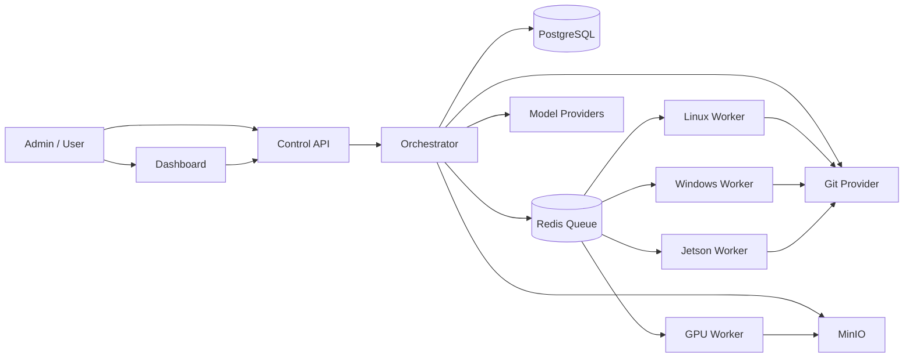
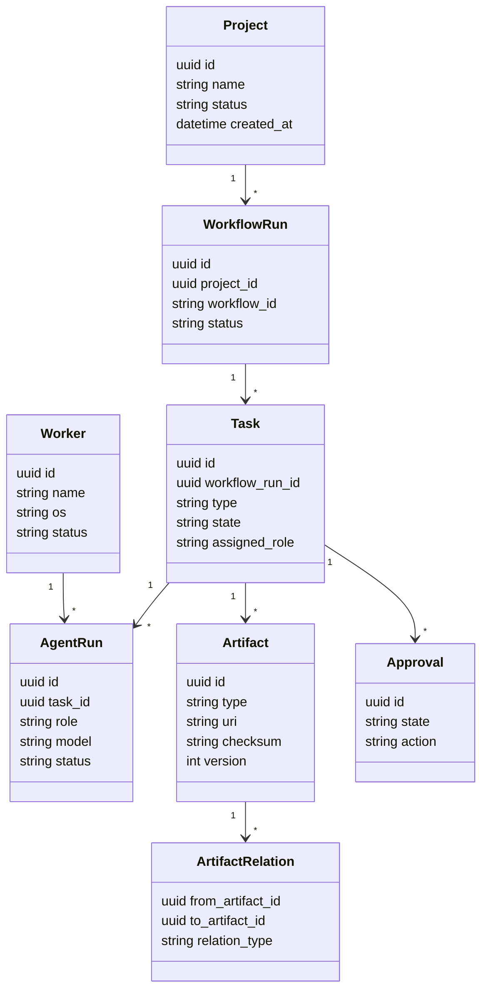

# AI WORK FACTORY — INITIAL TECHNICAL DESIGN

**Version:** 0.1  
**Status:** Initial architecture/design specification  
**Audience:** Developer / Codex / Claude Code / Solution Architect  
**Goal:** Định nghĩa bản thiết kế ban đầu đủ cụ thể để tạo repository và bắt đầu implementation Phase 0–1.

---

## 1. DESIGN GOALS

Hệ thống phải đáp ứng:

1. Workflow có state rõ ràng.
2. Agent chạy theo contract.
3. Agent không có quyền hệ thống ngoài permission được cấp.
4. Artifact có metadata và version.
5. Task có dependency graph.
6. Worker tách khỏi control plane.
7. Một coding task chạy trong sandbox riêng.
8. Mọi run có audit log.
9. Human approval là first-class entity.
10. Có thể thêm role/model/tool/workflow mà không sửa core logic lớn.

### Non-goals cho MVP

- Không xây swarm tự trị hoàn toàn.
- Không dùng Kubernetes.
- Không dùng Neo4j.
- Không fine-tune model.
- Không làm full video automation ngay.
- Không cho production autonomous deployment.

---

## 2. SYSTEM CONTEXT



---

## 3. LOGICAL COMPONENTS

### 3.1 `control-api`

REST API phục vụ:

- project management
- workflow execution
- task query
- approval
- artifact query
- worker registry
- observability data

### 3.2 `orchestrator`

Pure application/domain logic:

- start workflow
- transition stage
- schedule task
- handle result
- evaluate gate
- retry/fail
- request approval

### 3.3 `workflow-engine`

Chịu trách nhiệm:

- parse workflow YAML
- validate schema
- build stage graph
- evaluate dependencies
- transition state

### 3.4 `agent-runtime`

Chịu trách nhiệm:

- load agent profile
- load agent contract
- gather context
- call model adapter
- validate structured output
- create artifacts

### 3.5 `model-router`

Input:

- task type
- confidentiality
- complexity
- budget
- expected modality

Output:

- provider
- model class
- parameters

### 3.6 `tool-service`

Structured tool abstraction.

Không để agent tự sinh arbitrary shell command theo mặc định.

### 3.7 `worker-service`

Daemon chạy trên execution node.

Functions:

- register
- heartbeat
- poll/claim job
- prepare workspace
- run tool
- stream log
- submit result
- cleanup

### 3.8 `artifact-service`

Quản lý:

- metadata
- URI
- version
- checksum
- relations
- provenance

### 3.9 `approval-service`

Quản lý:

- approval request
- approver
- approval scope
- approve/reject
- comment
- expiry

---

## 4. INITIAL DEPLOYMENT TOPOLOGY

Phase 0:

```text
ONE UBUNTU HOST

Docker Compose
├── control-api
├── orchestrator-worker
├── postgres
├── redis
├── minio
└── dashboard

Native/Docker Linux Worker
```

Phase 2:

```text
Control Plane Host
├── API
├── DB
├── Queue
├── MinIO
└── Dashboard

Execution Nodes
├── Linux Worker
├── Windows Worker
├── Jetson Worker
└── GPU Worker
```

Control plane không phụ thuộc vào một worker cụ thể.

---

## 5. DOMAIN MODEL



---

## 6. DATABASE TABLES — MVP

### `projects`

```text
id UUID PK
name VARCHAR
slug VARCHAR UNIQUE
description TEXT
status VARCHAR
created_at TIMESTAMP
updated_at TIMESTAMP
```

### `workflow_runs`

```text
id UUID PK
project_id UUID FK
workflow_id VARCHAR
workflow_version VARCHAR
status VARCHAR
input_json JSONB
created_at
started_at
finished_at
```

### `tasks`

```text
id UUID PK
workflow_run_id UUID FK
parent_task_id UUID NULL
stage_id VARCHAR
task_type VARCHAR
title VARCHAR
description TEXT
state VARCHAR
assigned_role VARCHAR
priority INT
acceptance_criteria JSONB
created_at
updated_at
```

### `task_dependencies`

```text
task_id UUID
depends_on_task_id UUID
relation VARCHAR
```

### `agent_runs`

```text
id UUID PK
task_id UUID FK
role VARCHAR
profile_version VARCHAR
model_provider VARCHAR
model_name VARCHAR
status VARCHAR
input_json JSONB
output_json JSONB
token_input BIGINT
token_output BIGINT
cost_estimate NUMERIC
duration_ms BIGINT
error TEXT
created_at
finished_at
```

### `artifacts`

```text
id UUID PK
project_id UUID FK
task_id UUID NULL
type VARCHAR
name VARCHAR
storage_backend VARCHAR
uri TEXT
version INT
checksum VARCHAR
metadata JSONB
created_at
```

### `artifact_relations`

```text
id UUID PK
from_artifact_id UUID
to_artifact_id UUID
relation_type VARCHAR
metadata JSONB
```

### `workers`

```text
id UUID PK
name VARCHAR
platform VARCHAR
os_version VARCHAR
status VARCHAR
capabilities JSONB
labels JSONB
last_heartbeat TIMESTAMP
```

### `jobs`

```text
id UUID PK
task_id UUID FK
worker_id UUID NULL
job_type VARCHAR
payload JSONB
state VARCHAR
attempt INT
created_at
started_at
finished_at
```

### `approvals`

```text
id UUID PK
project_id UUID
task_id UUID NULL
action VARCHAR
state VARCHAR
requested_by VARCHAR
approved_by VARCHAR NULL
comment TEXT
created_at
resolved_at
```

### `audit_events`

```text
id UUID PK
project_id UUID
actor_type VARCHAR
actor_id VARCHAR
event_type VARCHAR
payload JSONB
created_at
```

---

## 7. API DESIGN — MVP

Base:

```text
/api/v1
```

### Projects

```http
POST   /projects
GET    /projects
GET    /projects/{project_id}
```

### Workflow

```http
POST   /projects/{project_id}/workflow-runs
GET    /workflow-runs/{run_id}
POST   /workflow-runs/{run_id}/cancel
```

### Tasks

```http
GET    /workflow-runs/{run_id}/tasks
GET    /tasks/{task_id}
POST   /tasks/{task_id}/retry
```

### Artifacts

```http
GET    /projects/{project_id}/artifacts
GET    /artifacts/{artifact_id}
GET    /artifacts/{artifact_id}/relations
```

### Approvals

```http
GET    /approvals?state=pending
POST   /approvals/{approval_id}/approve
POST   /approvals/{approval_id}/reject
```

### Workers

```http
POST   /workers/register
POST   /workers/{worker_id}/heartbeat
GET    /workers
```

### Worker Jobs

```http
POST   /workers/{worker_id}/claim
POST   /jobs/{job_id}/log
POST   /jobs/{job_id}/complete
POST   /jobs/{job_id}/fail
```

---

## 8. WORKFLOW SCHEMA

File:

```text
workflows/software-development.yaml
```

Example:

```yaml
id: software-development
version: "1.0"

inputs:
  - objective
  - repository

stages:
  - id: architecture
    role: engineering.solution-architect
    outputs:
      - architecture_document
    gate:
      type: human_approval

  - id: planning
    role: control.planner
    depends_on:
      - architecture

  - id: development
    role: engineering.developer
    foreach: planned_task
    depends_on:
      - planning

  - id: verification
    parallel:
      - role: engineering.test-engineer
      - role: engineering.static-reviewer
    depends_on:
      - development

  - id: review
    role: engineering.code-reviewer
    depends_on:
      - verification

  - id: qa
    role: engineering.qa
    depends_on:
      - review

  - id: final_gate
    gate:
      type: human_approval
    depends_on:
      - qa
```

---

## 9. AGENT PROFILE SCHEMA

```yaml
id: engineering.developer
version: "1.0"

model_policy:
  class: CODE_SPECIALIST
  fallback: REASONING

permissions:
  git:
    read: true
    branch_write: true
    protected_branch_write: false
  filesystem:
    workspace_write: true
  build: true
  test: true
  deploy: false

context:
  include:
    - task
    - acceptance_criteria
    - architecture
    - relevant_source_files
    - coding_standard

outputs:
  required:
    - implementation_summary
    - source_diff
    - test_evidence

completion_rules:
  - build_pass
  - unit_test_pass
```

---

## 10. TOOL CONTRACT DESIGN

Tool input/output phải typed.

Ví dụ Git diff:

```json
{
  "tool": "git.diff",
  "input": {
    "workspace_id": "...",
    "base": "main",
    "head": "agent/TASK-123"
  }
}
```

Response:

```json
{
  "status": "ok",
  "files_changed": 4,
  "insertions": 120,
  "deletions": 22,
  "artifact_id": "..."
}
```

Không trả raw shell nếu không cần.

---

## 11. WORKER PROTOCOL

### Registration

```json
{
  "name": "orin-worker-01",
  "platform": "linux-arm64",
  "capabilities": [
    "docker",
    "cmake",
    "python",
    "cuda",
    "realsense"
  ],
  "labels": {
    "device": "jetson-orin",
    "location": "lab"
  }
}
```

### Heartbeat

```json
{
  "status": "online",
  "cpu_load": 0.42,
  "memory_free_mb": 4200,
  "running_jobs": 1
}
```

### Job lifecycle

```text
QUEUED
→ CLAIMED
→ PREPARING
→ RUNNING
→ UPLOADING_RESULT
→ SUCCESS
```

Failure:

```text
RUNNING
→ FAILED
→ RETRYABLE / TERMINAL
```

---

## 12. SANDBOX DESIGN

MVP Linux implementation:

```text
/var/lib/ai-work-factory/workspaces/{job_id}/
```

Lifecycle:

```text
Create workspace
→ git clone/worktree
→ checkout task branch
→ inject read-only task context
→ run agent tools
→ build/test
→ collect artifacts/logs
→ commit/push if allowed
→ cleanup
```

Isolation:

- container preferred cho untrusted execution;
- workspace volume riêng;
- no host Docker socket cho agent nếu không cần;
- network deny/allow policy về sau.

---

## 13. ORCHESTRATOR PSEUDO FLOW

```python
run = create_workflow_run(project, workflow)

while not run.is_terminal():
    ready_tasks = workflow_engine.get_ready_tasks(run)

    for task in ready_tasks:
        if task.requires_approval():
            approval_service.ensure_request(task)
            continue

        route = task_router.resolve(task)
        agent_run = agent_runtime.prepare(task, route)
        job = scheduler.create_job(agent_run, route.worker_requirements)
        queue.publish(job)

    events = event_bus.consume(run.id)

    for event in events:
        state_manager.apply(event)
        critic.evaluate_if_required(event)
        workflow_engine.advance(run)
```

MVP có thể dùng polling/Redis queue trước; event bus phức tạp để Phase 2.

---

## 14. CRITIC DESIGN

Critic input:

- task objective
- acceptance criteria
- input artifact IDs
- output artifact IDs
- validation evidence

Critic output structured:

```json
{
  "decision": "PASS | CHANGES_REQUIRED | BLOCK",
  "findings": [
    {
      "severity": "BLOCKER",
      "code": "MISSING_ACCEPTANCE_EVIDENCE",
      "message": "..."
    }
  ],
  "recommended_next_action": "..."
}
```

Không dùng score 0–10 làm gate chính. Gate nên dựa trên rule + finding severity.

---

## 15. HUMAN APPROVAL DESIGN

Approval là resource độc lập.

Ví dụ:

```json
{
  "action": "approve_architecture",
  "scope": {
    "project_id": "...",
    "artifact_ids": ["architecture-artifact-id"]
  },
  "risk_level": 2,
  "state": "PENDING"
}
```

Sau approve, workflow mới transition.

Human gate MVP:

1. architecture approval
2. merge approval
3. production release approval

---

## 16. ARTIFACT PROVENANCE

Mỗi artifact phải có:

```text
artifact_id
project_id
task_id
agent_run_id
artifact_type
version
storage_uri
checksum
created_at
input_artifact_ids
```

Ví dụ source chain:

```text
PRD-001
→ ARCH-002
→ TASK-103
→ PR-044
→ TEST-044
```

---

## 17. INITIAL ADR LIST

Tạo ngay khi bootstrap repo:

### ADR-001 — Artifact-driven orchestration

Quyết định: agent handoff thông qua artifact + task state, không chat tự do.

### ADR-002 — PostgreSQL as initial system of record

Quyết định: PostgreSQL lưu state/metadata/relation; chưa dùng graph DB.

### ADR-003 — Workflow as configuration

Quyết định: workflow YAML/JSON, không hard-code pipeline.

### ADR-004 — Worker separated from control plane

Quyết định: execution chạy trên worker có capability riêng.

### ADR-005 — Human approval for high-risk actions

Quyết định: protected merge/production/destructive action không autonomous.

### ADR-006 — Structured Tool API over unrestricted shell

Quyết định: agent ưu tiên typed tools; shell là capability đặc biệt.

### ADR-007 — Ephemeral sandbox per coding task

Quyết định: mỗi task dùng workspace riêng.

---

## 18. SOURCE TREE — BOOTSTRAP

```text
ai-work-factory/
├── pyproject.toml
├── docker-compose.yml
├── .env.example
├── Makefile
├── README.md
│
├── apps/
│   ├── control_api/
│   │   └── src/
│   └── dashboard/
│
├── packages/
│   ├── domain/
│   ├── orchestrator/
│   ├── workflow_engine/
│   ├── agent_runtime/
│   ├── model_router/
│   ├── tool_sdk/
│   └── worker_sdk/
│
├── agents/
│   ├── contracts/
│   ├── profiles/
│   └── prompts/
│
├── workflows/
│   └── software-development.yaml
│
├── workers/
│   └── linux_worker/
│
├── infrastructure/
│   ├── migrations/
│   └── docker/
│
├── docs/
│   ├── architecture/
│   └── adr/
│
└── tests/
    ├── unit/
    ├── integration/
    └── e2e/
```

---

## 19. FIRST IMPLEMENTATION SPRINTS

### Sprint 0 — Bootstrap

Deliverables:

- repository
- Python project
- Docker Compose
- PostgreSQL
- Redis
- MinIO
- API health endpoint
- migration framework
- ADR folder

### Sprint 1 — Domain + Workflow

Deliverables:

- entities
- DB tables
- workflow schema
- workflow loader
- task state machine
- API create project/start workflow

### Sprint 2 — Worker + Tools

Deliverables:

- worker registration
- heartbeat
- job claim
- Git read/branch
- file read/write
- command wrapper
- build/test tool

### Sprint 3 — Agent Runtime

Deliverables:

- agent contract schema
- profile loader
- model adapter interface
- structured output validation
- Architect profile
- Developer profile

### Sprint 4 — Quality Loop

Deliverables:

- Tester
- Reviewer
- Critic
- retry/fix loop
- approval gate

### Sprint 5 — Dashboard + Demo

Deliverables:

- project screen
- workflow graph
- task/run screen
- approval queue
- demo feature trên repo thật

---

## 20. TEST STRATEGY FOR THE PLATFORM

### Unit

- state transitions
- workflow validation
- permission rules
- router rules
- artifact relationship logic

### Integration

- API ↔ DB
- Orchestrator ↔ Redis
- Worker ↔ Control API
- Artifact metadata ↔ MinIO

### E2E

Scenario:

```text
Create Project
→ Start Workflow
→ Architecture Task
→ Approval
→ Development Task
→ Build/Test
→ Review
→ Completion
```

### Failure tests

- worker offline
- model timeout
- malformed structured output
- build fail
- test fail
- critic block
- approval reject
- duplicate event

---

## 21. LOGGING / EVENT FORMAT

Structured JSON log:

```json
{
  "timestamp": "...",
  "level": "INFO",
  "project_id": "...",
  "workflow_run_id": "...",
  "task_id": "...",
  "agent_run_id": "...",
  "worker_id": "...",
  "event": "TASK_STARTED",
  "message": "..."
}
```

Core event types:

```text
PROJECT_CREATED
WORKFLOW_STARTED
TASK_READY
TASK_ASSIGNED
AGENT_STARTED
TOOL_CALLED
ARTIFACT_CREATED
TASK_FAILED
TASK_RETRY
CRITIC_BLOCKED
APPROVAL_REQUESTED
APPROVAL_GRANTED
TASK_COMPLETED
WORKFLOW_COMPLETED
```

---

## 22. SECURITY BASELINE

MVP security requirements:

- `.env` không commit.
- Worker token riêng.
- API auth từ sớm, không để anonymous khi mở LAN.
- Git credentials read/write theo repo.
- Production credentials không tồn tại trên coding worker.
- Audit log mọi tool action.
- Path traversal protection trong file tools.
- Command timeout.
- Output size limits.
- Secret redaction trong logs.

---

## 23. CONFIG EXAMPLE

### `config/system.yaml`

```yaml
system:
  environment: development

storage:
  database_url: ${DATABASE_URL}
  redis_url: ${REDIS_URL}
  object_store: minio

policies:
  production_deploy:
    approval_level: 2
  protected_branch_merge:
    approval_level: 2
  arbitrary_shell:
    default: deny

routing:
  default_worker: linux
  default_model_class: BALANCED
```

---

## 24. MVP DEMO SCENARIO

Repository demo:

```text
perception-service
```

Feature nhỏ gợi ý:

> Thêm camera pipeline health-check API + test + documentation.

Expected execution:

```text
1. User creates objective.
2. Planner creates requirement/tasks.
3. Architect generates design artifact.
4. User approves architecture.
5. Developer gets isolated workspace.
6. Developer implements feature.
7. Worker builds/tests.
8. Reviewer inspects diff.
9. Developer fixes findings if needed.
10. QA checks acceptance criteria.
11. System prepares PR.
12. Dashboard shows full trace.
```

Artifacts:

```text
REQ-health-check.md
ARCH-health-check.md
ADR-xxx.md
TASK graph
source diff
unit test report
integration test report
code review report
QA report
PR metadata
```

---

## 25. ACCEPTANCE CRITERIA FOR INITIAL PLATFORM

### Functional

- [ ] Tạo project qua API/UI.
- [ ] Start workflow từ config.
- [ ] Sinh task graph.
- [ ] Agent profile được load theo task.
- [ ] Worker nhận job.
- [ ] Build/test chạy trong workspace riêng.
- [ ] Artifact được lưu và version hóa.
- [ ] Critic có thể block task.
- [ ] Human approval có thể resume workflow.
- [ ] Workflow hoàn tất với audit trail.

### Quality

- [ ] Unit test core state machine.
- [ ] Integration test worker protocol.
- [ ] E2E demo chạy ổn định.
- [ ] Không có direct production credential.
- [ ] Không ghi secret vào log.

---

## 26. WHAT NOT TO BUILD YET

Tránh ngay trong Phase 0–1:

- Kubernetes.
- Microservices hóa mọi module.
- Neo4j.
- Vector DB riêng ngoài pgvector.
- autonomous production release.
- 20+ agent profiles.
- custom fine-tuned LLM.
- complex billing.
- complex event sourcing.

Mục tiêu là chứng minh **workflow + agent contract + worker + artifact + gate** trước.

---

## 27. DECISION CHECKPOINT SAU MVP

Sau khi demo end-to-end, đánh giá:

1. Có cần Temporal/LangGraph hay state engine hiện tại đủ?
2. Có cần graph DB hay PostgreSQL relation đủ?
3. Task routing theo rule có đủ hay cần optimizer?
4. Model router có tiết kiệm đáng kể không?
5. Worker isolation có cần container mạnh hơn?
6. Project memory có cải thiện chất lượng không?
7. Human gate nào có thể hạ mức tự động hóa?

Chỉ mở rộng sau khi có số liệu thực tế.

---

## 28. FINAL INITIAL ARCHITECTURE

```text
                     USER / ADMIN
                          │
                          ▼
                    CONTROL API
                          │
                          ▼
                     ORCHESTRATOR
                 ┌────────┼────────┐
                 ▼        ▼        ▼
              PLANNER   ROUTER   CRITIC
                 │        │        │
                 └────────┼────────┘
                          ▼
                   WORKFLOW ENGINE
                          │
                          ▼
                    AGENT RUNTIME
                          │
             ┌────────────┼────────────┐
             ▼            ▼            ▼
         MODEL ROUTER   TOOL API   KNOWLEDGE
                          │
                          ▼
                    POLICY ENGINE
                          │
                          ▼
                    JOB / QUEUE
                          │
           ┌──────────────┼──────────────┐
           ▼              ▼              ▼
       Linux Worker   Windows Worker   Jetson/GPU Worker
           │              │              │
           └──────────────┼──────────────┘
                          ▼
                    ARTIFACT STORE
                          │
                          ▼
                TRACEABILITY + AUDIT
```

Đây là kiến trúc ban đầu nên dùng làm baseline cho implementation.
