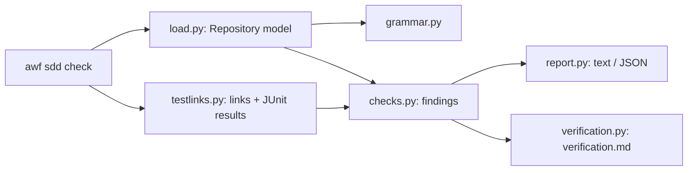

# Design for change 0001: SDD conformance checker

## Summary

A self-contained package `packages/awf/sdd/` reads the documents into a small model, runs checks as independent
functions that return findings, scans tests for links, joins them with a JUnit report, and renders the
verification file. `awf sdd check` in `packages/awf/cli.py` is a thin wrapper. Nothing in the package imports the
orchestrator, worker or API, so it can be extracted as is.

## Requirement mapping

| Requirement | Design elements | Notes |
|---|---|---|
| `FR-SDD-001` | `grammar.py` (front matter, items, fields, placeholders), `load.py` (walks `docs/sdd/`, builds the model) | every parsed element keeps its file and line |
| `FR-SDD-002` | `checks.py`: `check_ids`, register parsing in `load.py` | one repository-wide ID index |
| `FR-SDD-003` | `checks.py`: `check_change_spec` | status-aware for `SDD022` |
| `FR-SDD-004` | `checks.py`: `check_design`, `check_tasks` | skipped on Lightweight (profile from `load.py`) |
| `FR-SDD-005` | `testlinks.py` (scan + JUnit), `checks.py`: `check_test_links`, `check_results` | regex scan, no language parsers |
| `FR-SDD-006` | `verification.py` | deterministic rendering; `Manual checks` copied verbatim |
| `FR-SDD-007` | `cli.py` (`awf sdd check`), `report.py` (text and JSON), waivers in `checks.py` | exit codes 0 / 1 / 2 |
| `NFR-SDD-001` | `load.py` path confinement; no network import anywhere in the package | |
| `NFR-SDD-002` | single pass over files; compiled regexes; test scan reads each file once | |

## Components and responsibilities



| Module | Responsibility |
|---|---|
| `grammar.py` | split front matter; find `### <ID> — <title>` items and `- **Field:** value` lines with line numbers; find criteria bullets; parse Markdown tables; ID regexes; placeholder detection |
| `model.py` | dataclasses: `Document`, `Requirement`, `Criterion`, `Task`, `Question`, `Change`, `AreaSpec`, `Profile`, `TestLink`, `Finding` |
| `load.py` | read the profile (profile name, areas, allocation, exceptions), testing (convention, directories, report path), living specs (requirements, register), changes (spec, design, tasks, verification); confine paths to the root |
| `checks.py` | one function per check group, each `(repo, …) -> list[Finding]`; applies waivers last |
| `testlinks.py` | scan test files for the four conventions, attribute each link to the next test definition; parse JUnit XML into `{test name: result}` |
| `verification.py` | build the verification document from the model, links and results; keep `Manual checks` |
| `report.py` | human output (grouped by file) and JSON output |

## Interfaces and contracts

Command line (`FR-SDD-007`):

```text
awf sdd check [--root PATH] [--change NNNN | --all-open-changes] [--junit PATH] [--revision SHA]
              [--write-verification] [--json]
```

- Default: `--root .` and `--all-open-changes`.
- `--write-verification` requires `--change` (one file at a time) and writes
  `docs/sdd/changes/<NNNN>-*/verification.md`.

JSON output:

```json
{"findings": [{"code": "SDD030", "severity": "error", "path": "docs/sdd/changes/0001-x/design.md",
               "line": 12, "message": "…", "waived": false}],
 "coverage": {"must_criteria_passing": [3, 4], "requirements_with_verification": [7, 7],
              "tasks_with_requirements": [6, 7], "manual_checks_with_evidence": [0, 0]},
 "errors": 1, "warnings": 0}
```

Python interface for AWF later (roadmap 3.2): `awf.sdd.check(root, change=None, junit=None) -> Result` with the
same fields, so stages need no subprocess.

Test-link conventions (`FR-SDD-005.1`), one regex each, applied to every file under the scanned directories:

| Convention | Pattern (simplified) | Test the link belongs to |
|---|---|---|
| pytest marker | `@pytest.mark.req("ID", …)` | next `def test_…` |
| xUnit trait | `[Trait("Req", "ID")]` | next method name |
| `REQ:` comment | `// REQ: ID` or `# REQ: ID` | next test definition (`def`, method, `TEST(…)`, `test(`/`it(`) |
| title | `"… [ID] …"` inside `test(` / `it(` | that test |

JUnit matching: a link's test name is matched against `testcase@name`, ignoring parameter suffixes (`[…]`);
`failure` or `error` → failed, `skipped` → not run, otherwise passed.

## Data model and persistence

Not applicable: the checker keeps no state. The model is built in memory for each run.

## Runtime behaviour and failures

- **Normal path:** load → scan tests → parse report → run checks → print → optionally write verification.
- **Expected failures:**
  - unreadable or missing root → exit 2;
  - malformed YAML → `SDD002`, continue with the other files;
  - malformed JUnit → exit 2 with the parser message;
  - a document the grammar cannot parse at all → `SDD002`, its items skipped.
- **Timeouts / retries:** Not applicable: local file reads only.
- **Recovery / restart:** Not applicable: stateless.
- **Observability:** findings are the output; `--json` for machines.

## Security, privacy and safety

- **Trust boundaries:** repository content is data. YAML is read with `safe_load`. Nothing is executed (tests are
  scanned as text, not imported).
- **Secrets / credentials:** none read or written.
- **Permissions:** writes only the requested verification file, after confirming its resolved path is under the
  root (`NFR-SDD-001.2`).
- **Threats / mitigations:** path traversal through change folder names (rejected); YAML tags (`safe_load`).
- **Hazards and safe state:** Not applicable: no physical system.

## Performance and resource budgets

| Concern | Target / budget | Measurement | Requirement |
|---|---|---|---|
| wall time | under 10 s for 50 changes and 2,000 test files | test that generates such a repository and times the run | `NFR-SDD-002` |

## Deployment, compatibility and rollback

- **Configuration changes:** a `req` marker registered in `pyproject.toml` so pytest accepts it.
- **Upgrade path:** none; new command.
- **Backward compatibility:** no existing behaviour changes.
- **Rollback:** revert the change; nothing depends on it yet.

## Alternatives

| Option | Benefits | Costs / risks | Decision |
|---|---|---|---|
| Regex-based Markdown reading over the fixed grammar | no new dependency; line numbers are easy; grammar is small | stricter than a Markdown parser about formatting | Selected |
| A Markdown AST library (e.g. markdown-it-py) | robust to formatting variants | new dependency; line mapping for list fields is awkward | Rejected |
| Parse test files with language parsers (ast, Roslyn, clang) | exact test attribution | three toolchains; slow; breaks extraction | Rejected: regexes per convention are enough for the documented conventions |
| Pytest plugin collecting markers at run time | exact for Python | Python only; needs the tests to run | Rejected for the checker; may be added later for richer reports |

## Decisions

None (the choices above are local to this change).
