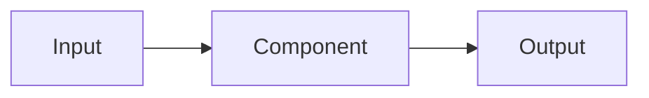

# Design for change <NNNN>: <title>

## Summary

<The solution, and why it satisfies the change spec.>

## Requirement mapping

Every requirement under `Added` or `Modified` in the change spec appears here.

| Requirement | Design elements | Notes |
|---|---|---|
| `FR-<AREA>-<NNN>` | <module / interface / flow, or `DES-<NNNN>-01`> | <trade-offs> |

## Components and responsibilities

<Components and their boundaries. A diagram where it helps.>

## Interfaces and contracts

For each API, event, message, protocol or hardware interface: purpose and owner; inputs/outputs and types;
validation and errors; timeout, retry and idempotency; compatibility and versioning; authentication and
authorisation. Or `Not applicable: <reason>`.

## Data model and persistence

- **Entities / schemas:** <description or Not applicable: reason>
- **Invariants:** <rules>
- **Migration / rollback:** <approach or Not applicable: reason>
- **Retention / deletion:** <rules or Not applicable: reason>
- **Data sensitivity:** <classification or Not applicable: reason>

## Runtime behaviour and failures

- **Normal path:** <sequence>
- **Expected failures:** <failure → response>
- **Timeouts / retries:** <policy>
- **Recovery / restart:** <policy>
- **Observability:** <logs, metrics, alarms>

## Security, privacy and safety

- **Trust boundaries:** <description>
- **Secrets / credentials:** <storage, rotation>
- **Permissions:** <least-privilege model>
- **Threats / mitigations:** <list or link>
- **Hazards and safe state:** <when applicable, or Not applicable: reason>

## Performance and resource budgets

| Concern | Target / budget | Measurement | Requirement |
|---|---|---|---|
| <latency / throughput / CPU / memory> | <target> | <method> | `NFR-<AREA>-<NNN>` |

## Deployment, compatibility and rollback

- **Configuration changes:** <description>
- **Upgrade path:** <description>
- **Backward compatibility:** <description>
- **Rollback:** <description>

## Alternatives

| Option | Benefits | Costs / risks | Decision |
|---|---|---|---|
| <option> | <benefits> | <costs> | <Selected / Rejected> |

## Decisions

<ADR links, or None.>
